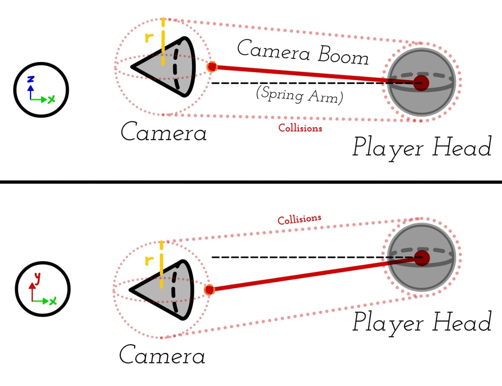
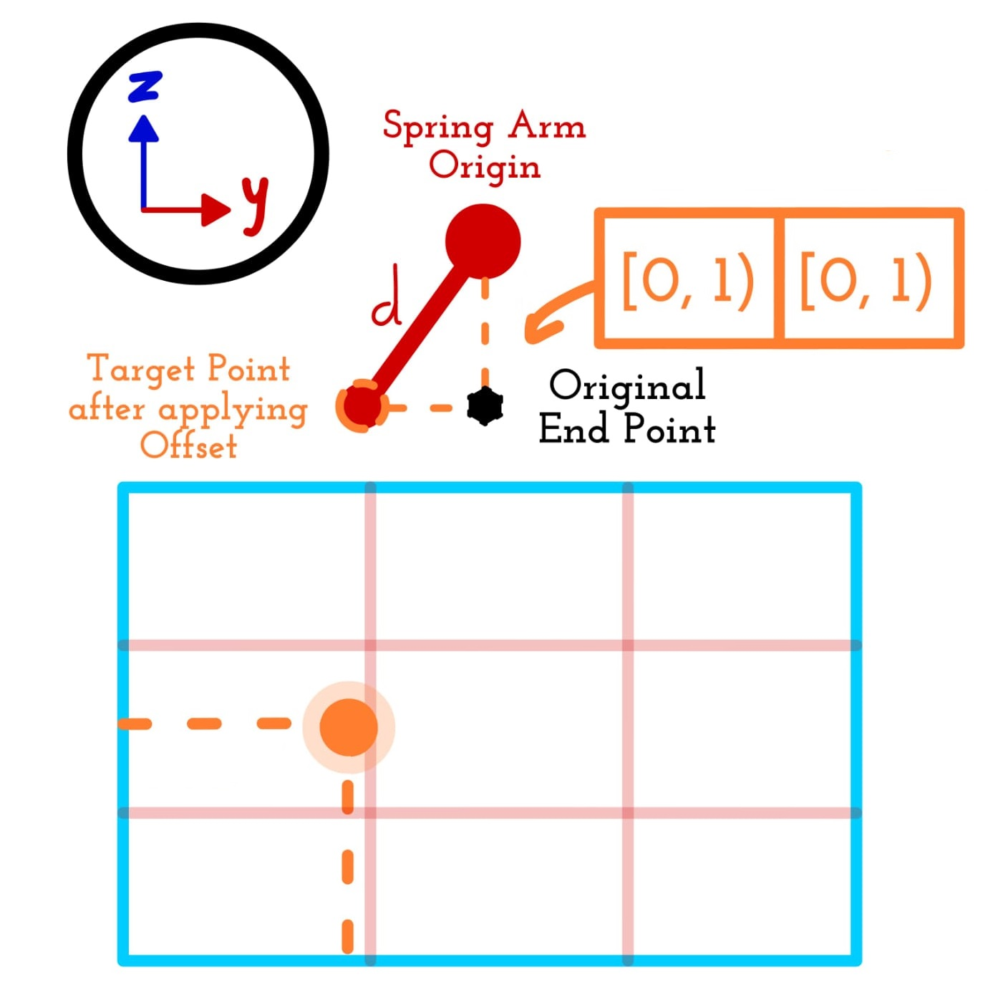
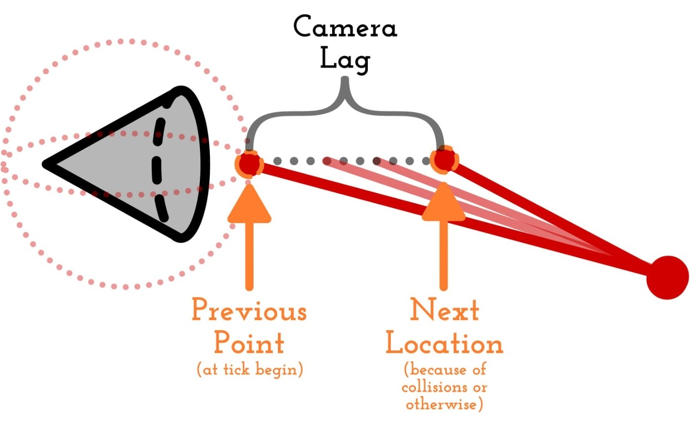
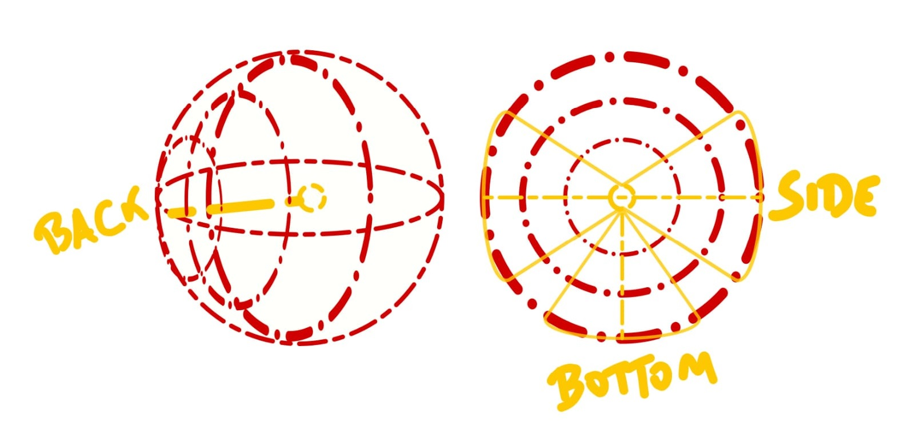
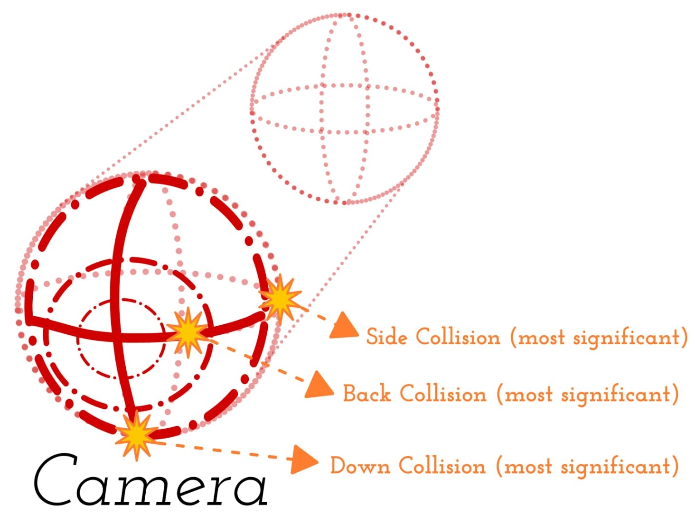
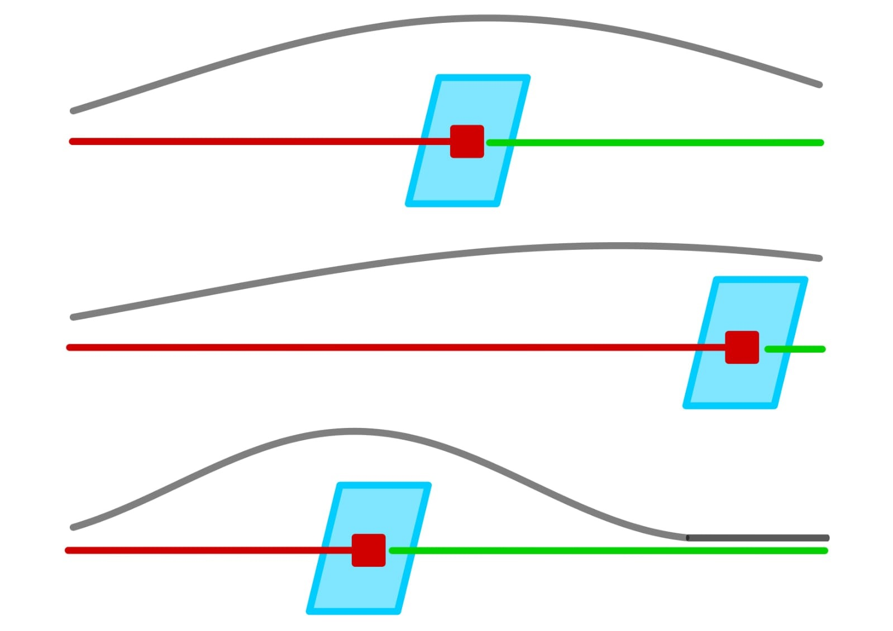

Lady Umbrella is a 3d action-adventure shooter in which the player plays the role of special agent Francesca De Angelis (aka Lady Umbrella) who, while infiltrating the last mafia family in Italy, is betrayed and incriminated by her partner. She must now clear her name by preventing her own agency from arresting her, and defeating the mafia using her main weapon: a high-tech shotgun umbrella that functions as a shield and contains multiple hidden gadgets.

> 🎮 Check [Lady Umbrella](https://store.steampowered.com/app/3956890/Lady_Umbrella/) out on Steam.

This project was made as part of a Educa. It was done in Unreal Engine 5.5.3 and completely in C++ (except for material shaders, animation blueprints and some small trigger events). 

Although there is a lot of effort from a lot of people in the fame packed in the game taking the shape of the different systems it is made of; today I will be focusing on one of the biggest parts I implemented: the Camera System.

# Camera System Overview

This is a custom camera system that handles everything from collisions to aiming; specifically:

- **Collision Detection.** The way the camera must react when hitting a wall or finding an obstacle.
- **Camera States.** The camera handles configuration for different contexts via states.
- **Camera Contextual Control.** Given that the camera has the previously mentioned states, it must be able to handle how the player uses and swaps between them.
- **Camera Assistance on movement.** What happens if there is no camera input?
- **Camera Context Shakes.** There has been an explosion!! _Shouldn't the camera also react?_
- **Design Focused Customizations (as requested).** Some of the shape, variables and functionalities that dictate the implementation of this system come directly from collaborative work with the design team.

||
|:---:|
|  | 
| Diagram of Camera Component's structure, made of a Camera and its Camera Boom. As you can see, the Camera is slightly offeseted towards the top right from the straight line one would expect. |

> 🚨 **Important**
>
> This is the implementation I landed on given the time
> constraints and context attached to Lady Umbrella's
> development. With this I mean to say this may not be the
> best approach — admittedly it's a bit bloated — but it's what worked for me.

> 📝 **Note**
>
> The code that will appear in the snippets from this point onwards may include small corrections that were not on the source code (mostly name and order of functions and variables to ease the understanding).

## Ticking with the Player

```cpp
void UCustomCameraSystemComponent::CameraTick(const float& DeltaSeconds)
{
  if (IsValid(CameraBoom) && IsValid(FollowCamera))
  {
    UpdateForCameraState(DeltaSeconds);
    if (bCameraIsResetting)
    {
      ResetCamProgress(GetWorld()->GetDeltaSeconds());
    }
    ManageCameraCollisions();
    UpdateCameraContext(DeltaSeconds);
  }
}
```

This shows the order in which everything that is _"real time"_ or rather frame-based, is handled. Almost everything in the system is related somehow to one of the functions within `CameraTick()`.

Additionally, given there is a heavy reliance on interpolation, the order in which each task is handled inside of `CameraTick()` is really important. If the camera checked for collisions before updating the interpolating position, we might find that, after interpolating, the camera runs into wall; however, the collision adjustment isn't made until a the next frame; or even worse, we start a loop of correcting according to collisions one frame and interpolating back the next.

The same thing happens when we are resetting the camera, which is why **we leave the collision management for last and only once we have a definitive position do we actually adjust the camera**.

> 📝 **Note**
>
> I use easing functions to interpolate the camera's
> position. However, since they are their own topic, I won't
> be getting much into them, so I recommend you check out
> [easing.net](https://easings.net/) if you are curious.

# Camera State

The camera system is based on a map of `FCameraState`s that holds the configuration for how the camera should react and adjust for every different context. The states for the camera are:

|State|Description|
|:--|:--|
| `DEFAULT` | Regular 3rd person camera. |
| `LOOKAT`* | When a context action is triggered, takes over the camera to look at a relevant context-predetermined location. |
| `COVER`* | This is handled on the [cover system by Pablo Granado](https://github.com/Veguista/LadyUmbrella-CoverSystem). There is an initial approach implemented on the camera system which is what we will talk about. |
| `AIM` | While the player is aiming to shoot, the camera moves to their shoulder to ease aiming and shooting. |
| `SHIELD` | When the umbrella is open positions itself to give a clearer view through the shield. |

_* Requires another actor or component to work (other than the player)._

Now, what does one of this states control? Well, here are the variables:

| Variable | Type | Usage | Notes |
|:---------|:----:|:-----:|:------|
|`bFocusDistanceDynamic`|`bool`| Camera view. | Dynamically change camera's focus depending on what the player is aiming at. |
|`bUseFoVForLOD`|`bool`| Camera view. | — |
|`DesiredScreenRatio`|`FVector2`| Finding target position. | Position in the screen in which the head of the player — or wherever the camera is attached to — should be. |
|`bScreenRatioMirrored`|`bool`| Finding target position. | Uses mirror of `DesiredScreenRatio` instead — for example, to change the camera shoulder. |
|`Distance`|`float`| Finding target position. | Distance between the camera and the attachment location. |
|`AttachmentLocation`|`enum`| Finding target position. | Either be the top of the capsule, the top of the mesh or the weapon muzzle. |
|`WallHitThreshold`|`float`| Compute collisions. | — |
|`SideHitThreshold`|`float`| Compute collisions. | — |
|`BottomHitThreshold`|`float`| Compute collisions. | — |
|`InterpolationType`|`enum`| Handling movement. | Linear interpolation, regular easing, elastic easing — both with in, out and in-out — or `CUSTOM` if we want to use `BezierPoints`. |
|`EaseExponent`|`float`| Handling movement. | In case we are using easing, what power we use. |
|`BezierPoints`|`FVector4`| Handling movement. | Values to create a curve, similar to how it is done for CSS. |
|`InterpolationSpeed`|`float`| Handling movement. | — |
|`bAfterCollisionDelay`|`bool`| Handling movement. | — |
|`DelaySeconds`|`float`| Handling movement. | — |
|`bCameraLag`|`bool`| Handling movement. | Wether to use the built in lag in the camera boom or not. |

This seems like a whole lot — because it is — but I won't be going into it all at once. Let's try to focus instead on where each variable is used and how.

# Calculating the Target Location

- Offsets and so on

||
|:---:|
|  |
| Diagram showing the relation of the offset in the camera boom and the desired position for its origin on the screen. |

## Switching between Targets

> 📝 **Note**
>
> There are some states that take advantage of the Spring Arm's builtin camera lag to smooth the movement — regardless of the context in which it is being done: player movement, rotating the camera, etc.
> ||
> |:---:|
> |  |
> | Diagram illustrating how the camera lag takes effect. |

# Letting the Player move the Camera

Let me begin by showing you how the player actually controls the camera by checking the `Look()` and `StopLook()` functions inside of `APlayerCharacter`.

```cpp
// APlayerCharacter.cpp

// On the constructor we bind the functions to an event
EnhancedInput->BindAction(FInputAssets::LookAction,     ETriggerEvent::Triggered, this, &APlayerCharacter::Look);
EnhancedInput->BindAction(FInputAssets::LookAction,     ETriggerEvent::Completed, this, &APlayerCharacter::StopLook);

void APlayerCharacter::Look(const FInputActionValue& Value)
{
  //...

  const FVector2D LookAxisVector = CameraSystemComponent->GetAdjustedLookVector(FGlobalPointers::MainController->GetInputDevice(), Value.Get<FVector2D>());
  AddControllerYawInput(LookAxisVector.X * GetCameraSystemComponent()->GetCameraLookMultiplierAimAssist());
  AddControllerPitchInput(LookAxisVector.Y * GetCameraSystemComponent()->GetCameraLookMultiplierAimAssist());
}

void APlayerCharacter::StopLook(const FInputActionValue& Value)
{
  if (GetPlayerGeneralState() == EPlayerState::ControlsDisabled || !IsValid(CameraSystemComponent))
  {
    return;
  }

  CameraSystemComponent->SetCameraInputMotion(ECameraInputSpeed::DECELERATING);
}

```

If you are familiar with the player camera control inside Unreal Engine's 3D template, you may notice how the Look() function is not too different to the default builtin one. The big differences are that we process the input vector directly from the controller with `GetAdjustedLookVector()`, and then we apply the aim assist related modifiers.

> 📝 **Note**
>
> To know how aim assist was handled in the project, you can check the [`AimAssistComponent`](https://github.com/PAlexUtad/lady-umbrella-portfolio/tree/main/Source/LadyUmbrella/Components/AimAssistComponent) implemented by [Alexandre Pages](https://github.com/PAlexUtad)

## Ramp up and slow down

How we ramp up and slow down the camera's look vector is clear once we look at the implementation of `GetAdjustedLookVector()` and `GetDeceleratingLookVector()`.

```cpp
FVector2D UCustomCameraSystemComponent::GetAdjustedLookVector(FString DeviceType, FVector2D LookAxisVector)
{
  // Let's check first wether we can move the camera
  if (GetCurrentCameraStateKey() == ECameraStateKey::LOOKAT)
  {
    return FVector2D::ZeroVector;
  }

  // Have we reached maximum speed?
  if (CurrentInputSpeedState != ECameraInputSpeed::PEAKED)
  {
    // Linearly ramp up speed from 0 to 1 by `InputAccelerationRate` each frame
    CurrentAccelerationInput = FMath::Min(CurrentAccelerationInput + InputAccelerationRate, 1.f);
    SetCameraInputMotion(CurrentAccelerationInput < 1 ? ECameraInputSpeed::ACCELERATING : ECameraInputSpeed::PEAKED);
  }


  FCameraMultipliers ActiveMultipliers = CameraMultipliers[FName(DeviceType)];

  // Apply acceleration modification to original input
  float ResultX = LookAxisVector.X * CurrentAccelerationInput;
  float ResultY = LookAxisVector.Y * CurrentAccelerationInput;

  // Apply designer custom sensibility ramp up curve, if there is one for this device
  if (ActiveMultipliers.bSensibilityFitsCurve)
  {
    if (IsValid(ManualYawCurve) && IsValid(ManualPitchCurve))
    {
      ResultX = ManualYawCurve->GetFloatValue(FMath::Abs(ResultX)) * (ResultX/FMath::Abs(ResultX));
      ResultY = ManualPitchCurve->GetFloatValue(FMath::Abs(ResultY)) * (ResultY/FMath::Abs(ResultY));
    }
    else
    {
      UE_LOG(LogTemp, Error, TEXT("Yaw or Pitch Curve are invalid. Unable to do adjust Input to curve."));
    }
  }

  // Apply `ActiveMultipliers` to input
  ResultX *= (ActiveMultipliers.bInvertYaw ? -1 : 1) * ActiveMultipliers.SensibilityX;
  ResultY *= (ActiveMultipliers.bInvertPitch ? -1 : 1) * ActiveMultipliers.SensibilityY;

  if (GetCurrentCameraStateKey() == ECameraStateKey::AIM)
  {
    ResultX *= ActiveMultipliers.AimMultiplier;
    ResultY *= ActiveMultipliers.AimMultiplier;
  }
  else
  {
    ResultX *= ActiveMultipliers.DefaultMultiplier;
    ResultY *= ActiveMultipliers.DefaultMultiplier;
  }

  // Looking while on Cover prototype

  // Package result
  PreviousInputAdjust = FVector2D(ResultX, ResultY);
  return PreviousInputAdjust;
}
```

We linearly increase the current velocity — starting at zero — by a fixed value (between `0.001f` and `1.0f`) and, once we have reached 1, we stop the ramp up and change the input motion from `ACCELERATING` to `PEAKED` to prevent further ramp up calculations.

Regarding deceleration, we have to look not only at the implementation of the previously mentioned function; but at the camera-related section within `APlayerCharacter::Tick(float DeltaTime)`:

```cpp

void APlayerCharacter::Tick(const float DeltaTime)
{
  //...

  if (IsValid(CameraSystemComponent))
  {
    GetCameraSystemComponent()->CameraTick(DeltaTime);
    if(GetCameraSystemComponent()->GetCameraInputMotion() == ECameraInputSpeed::DECELERATING)
    {
      FVector2D DeceleratingInput = CameraSystemComponent->GetDeceleratingLookVector(DeltaTime);
      AddControllerYawInput(DeceleratingInput.X);
      AddControllerPitchInput(DeceleratingInput.Y);
    }
    if (PreviousTickLocation == GetActorLocation())
    {
      GetCameraSystemComponent()->MakeCameraShake(EShakeSource::IDLE);
    }
  }
  PreviousTickLocation = GetActorLocation();

  //...
}
```

On stop look, we set the motion input to `DECELERATING`; then, on the player's tick, we decelerate until we stop completely the same way we accelerated before (this time handled by `GetDeceleratingLookVector()`).

```cpp
FVector2D UCustomCameraSystemComponent::GetDeceleratingLookVector(float DeltaTime)
{
  CurrentAccelerationInput = FMath::Max(CurrentAccelerationInput - InputDecelerationRate, 0.f);
  SetCameraInputMotion(CurrentAccelerationInput > 0.f ? ECameraInputSpeed::DECELERATING : ECameraInputSpeed::STATIC);
  return PreviousInputAdjust * CurrentAccelerationInput;
}
```

## Camera Multipliers

You might have noticed on the previous code snippets, that at a certain point we apply multipliers based on the `DeviceType` variable. This is a set of values that are meant to modify the input depending on if we are using a keyboard or a controller so that they both feel smooth. These variables are:

| Variable | Description |
|:--------:|:------------|
| `SensibilityRange` | Min to max value the input can be multiplied by. |
| `SensibilityX` | Used to modify the strength of the input on the X axis. |
| `SensibilityY` | Used to modify the strength of the input on the Y axis. |
| `bSensibilityFitsCurve` | Wether to use the provided curves instead of a plain multiplier. |
| `bSensibilityFitsCurve` | Wether to use the provided curves instead of a plain multiplier. |
| `AimMultiplierRange` | Just as before but now depending on how the camera is being used by the player. |
| `AimMultiplier` | Used to modify the strength of the input while aiming. |
| `DefaultMultiplier` | Used to modify the strength of the input while moving the camera normally. |
| `bInvertYaw` | Multiply the Yaw input by -1. |
| `bInvertPitch` | Multiply the Pitch input by -1. |

## Assistance

| Related Variables          | Description               |
|:--------------------------:|:--------------------------|
| `CameraMoveAssistStrength` | How much force should de automatic adjustment use. |
| `YawAssistanceTimer`       | Internal countdown timer. It is set to delay whenever the camera stays `STATIC` while the Player is on motion. |
| `YawAssistanceDelay`       | How much to wait until we begin applying the camera assistance. |

When active, the camera's Yaw movement moves complementary to player's movement if there no camera control input is made. The following function is called inside of `APlayerCharacter::Move()`.

```cpp
void UCustomCameraSystemComponent::MoveAssistance(const FVector2D& MoveAxisVector, const bool bMoveControlledByCover) const
{
  // Check if there is no camera-related input being made
  if (CurrentInputSpeedState != ECameraInputSpeed::STATIC || GetCurrentCameraStateKey() != ECameraStateKey::DEFAULT)
  {
    return;
  }

  // Check where we are moving
  FVector2D NormalizedMovementVector = MoveAxisVector.GetSafeNormal();

  // If anything other than straight forward, apply camera assistance in the direction of the movement
  if (YawAssistanceTimer <= 0.f && !bMoveControlledByCover && IsValid(FGlobalPointers::MainController))
  {
    FGlobalPointers::MainController->AddYawInput(NormalizedMovementVector.X * CameraMoveAssistStrength);
  }
}
```

> 📝 **Note**
>
> The camera assistance can be toggle by setting  `bYawAssistance` — false by default.

## Resetting the Camera

| Related Variables    | Description               |
|:--------------------:|:--------------------------|
| `ResetStepSize`      | Amount the camera should move at a time. |
| `bCameraIsResetting` | `false` by default, serves only as an indicator. |


One can begin resetting the camera by calling `ResetCameraPosition()` from anywhere.

```cpp
void UCustomCameraSystemComponent::ResetCameraPosition()
{
  if (IsValid(FGlobalPointers::MainController))
  {
    // Prevent any input while resetting. Since the reset should be very quick there should be no problem.
    FGlobalPointers::MainController->DisableInput(FGlobalPointers::MainController);
    bCameraIsResetting = true;
  }
}
```

Then, going back to the `CameraTick()` function I presented in the beginning, the camera moves a step towards the default position.

```cpp
void UCustomCameraSystemComponent::CameraTick(const float& DeltaSeconds)
{
  
  //...
  
  if (bCameraIsResetting)
  {
    ResetCamProgress(GetWorld()->GetDeltaSeconds());
  }

  //...

}
```

And, to do that (and to check when it's done and input can be reenabled), one can use the controller rotation like so:

```cpp

void UCustomCameraSystemComponent::ResetCamProgress(const double& DeltaSeconds)
{
  if (!IsValid(FGlobalPointers::MainController))
  {
    return;
  }

  // Current Rotation
  FRotator ControlRot = FGlobalPointers::MainController->GetControlRotation();
  FQuat ControlQuat = ControlRot.Quaternion();

  // Difference between rotations
  const float AngularDistance = FMath::RadiansToDegrees(UKismetMathLibrary::Quat_AngularDistance(ControlQuat, ControlQuat));
  const float AngularThreshold = 1.0f;

  if (AngularDistance > AngularThreshold)
  {
    // Interpolate
    FQuat InterpolatedQuat = FQuat::Slerp(ControlQuat, ControlQuat, DeltaSeconds * ResetStepSize);
        FGlobalPointers::MainController->SetControlRotation(InterpolatedQuat.Rotator());
  }
  else
  {
    // Restore input
    FGlobalPointers::MainController->EnableInput(FGlobalPointers::MainController);
    bCameraIsResetting = false;
  }
}
```

## Other options

There are many more functions related with customizing the player experience (wether by the player, the designers or by other systems). As getting into them would be a bit too much, I'll gather them here for you with a little explanation on how they work and how they are used — excluding some getters and setters.

| Function | Entry Variables | Description |
|:--------:|:---------------:|:------------|
| `UpdateCurrentControlSensitivity (FString&, float, bool)` | `DeviceType`, `NewValue`, `bHorizontal` | When updating the sensibility, we modify the multiplier but ensuring it is always within the provided range. |
| `UpdateModifier (FString&, EModifierType, float)`  | `DeviceType`, `Modifier`, `NewValue` | We change the given `DeviceType` multiplier related to the provided modifier — for example, keyboard multiplier related to aiming. |
| `UpdateModifier (EModifierType, TArray<float>)` | `Modifier`, `NewValues` | We change all multipliers related to the provided modifier — for example, every multiplier related to aiming. |
| `SetCameraStateShoulder (ECameraStateKey, bool)` | `StateKey`, `InvertedShoulder` | Sets whether the shoulder (offset) should be the opposite of the default (mirrored) for the provided state (and resets related timers). |
| `SetCameraStateOffsetValue (ECameraStateKey, FVector2D)` | `StateKey`, `Ratio` | Sets the offset for the provided state (and resets related timers). this is used on other systems. |

# When the Camera bumps into something

So, collisions... How does one handle those? Well, carefully. It really depends on what you are trying to achieve. In our case we have both inside (with columns and small spaces) and outside environments (more permissive but still with bothersome elements like covers). This means we have to be mindful not only of the collisions we might encounter from behind the camera, but also from the ones on the sides and in between the camera and the spring arm's location.

```cpp
void UCustomCameraSystemComponent::ManageCameraCollisions()
{
  FCameraState State = GetCurrentCameraState();

  const FVector Start = GetCameraBoom()->GetComponentLocation();
  const FVector End	= Start + GetCameraBoom()->TargetOffset - GetCameraBoom()->GetTargetRotation().Vector() * GetCameraBoom()->TargetArmLength;

  CameraHits.Empty();
  bool bHasCollided = UKismetSystemLibrary::SphereTraceMulti(
    GetWorld(),
    Start,
    End,
    CameraCollisionRadius,
    ETraceTypeQuery::TraceTypeQuery1,
    true,
    IgnoredActorsCamera,
    EDrawDebugTrace::None,
    CameraHits,
    true);

  if (bHasCollided)
  {
    // Process collision
  }
  else
  {
    // If we ain't hitting nothing, we probably want to go back.
    TargetBoomLength = State.Distance;
    GetCameraBoom()->bDoCollisionTest = false;
  }
}
```

> **Note**
>
> A few actors to be ignored are set up and gathered on begin play. To do this, I get any actor tagged with _"Camera Ignore"_ within the level on `BeginPlay()`.
>
> ```cpp
> void UCustomCameraSystemComponent::BeginPlay()
> {
>   Super::BeginPlay();
>
>   // Ignored Actors in regard to avoidance and collision
>   TArray<AActor*> CameraTaggedActors;
>   UGameplayStatics::GetAllActorsWithTag(GetWorld(), FName("CameraIgnore"), CameraTaggedActors);
>   for (AActor* CameraTaggedActor : CameraTaggedActors)
>   {
>     IgnoredActorsCamera.Add(CameraTaggedActor);
>   }
> 
>   //...
> 
> }
> ```

So, now that I know if something relevant has collided with it, what do I do with that information? 

```cpp
UCustomCameraSystemComponent::ManageCameraCollisions()
{
  //...
  
  if (bHasCollided)
  {
    if (State.bAfterCollisionDelay)
    {
      DelayedCollisionTimer = State.DelaySeconds;
    }

    if (!FMath::IsNearlyEqual(InterpolationStart_Dist, GetCameraBoom()->TargetArmLength))
    {
      InterpolationStart_Dist = GetCameraBoom()->TargetArmLength;
    }
    InterpolationStart_Offset = CurrentOffset;
    
    FHitResult SynthesizedHit;
    SynthesizedHit.Normal		= FVector::ZeroVector;
    SynthesizedHit.Location		= FVector::ZeroVector;
    SynthesizedHit.ImpactPoint	= FVector::ZeroVector;

    for (const FHitResult& Hit : CameraHits)
    {
      SynthesizedHit.Normal		+= Hit.Normal;
      SynthesizedHit.Location		+= Hit.Location;
      SynthesizedHit.ImpactPoint	+= Hit.ImpactPoint;
    }

    SynthesizedHit.Normal		/= CameraHits.Num();
    SynthesizedHit.Location		/= CameraHits.Num();
    SynthesizedHit.ImpactPoint	/= CameraHits.Num();
    
    EvaluateCollision(SynthesizedHit);
  }
}

```

||
|:---:|
|  | 
| . |

||
|:---:|
|  | 
| . |

# Other Stuff

There are a couple of things that are related with the camera but aren't really relevant to the system's inner workings.

## Camera Shakes

| Shakes Enum   | Where are they used?                      |
|:-------------:|:------------------------------------------|
| `RECOIL`        | Played on shoot. |
| `GADGET_RECOIL` | Played on hook use. |
| `DIAGONAL`      | Following the melee direction. |
| `IDLE`          | Natural camera bobbing. |
| `SWAY`          | While on a zipline. |
| `SWING`         | Player launches from a bar or rope. |
| `VIBRATION`     | Vibrating Sway. |
| `IMPACT`        | Receiving impacts on the shield or landing hits with gadgets. |
| `ENVIRONMENT`   | Explosions or other environment elements. |
| `UNKNOWN`       | Default, miscellaneous usage. |

Sometimes, we want the camera to shake or wiggle in reaction to something that happened on another system. This is why we provide `MakeCameraShake()`, which is called — most usually — by the Player. We store all the types of shakes in the `CameraShakes` map which is indexed by the `EShakeSource` custom enumerator.

Declaration of camera shake:

```cpp
// On the header file
TMap<EShakeSource, TSubclassOf<class UCameraShakeBase>> CameraShakes;
  
// On the class constructor
CameraShakes.Add(
  EShakeSource::RECOIL,
  AssetUtils::FindClass<ULegacyCameraShake>(TEXT("/Script/Engine.Blueprint'/Game/Blueprints/CameraShakes/BP_ShakePlayer.BP_ShakePlayer_C'")));
```

We use builtin `UGameplayStatics::PlayWorldCameraShake` to
create the shake effects. We wrap it in a function that can be called from outside the system with or without a source location.

```cpp
// On header file
void MakeCameraShake(const EShakeSource& Type, FVector Location = FVector(0.f, 0.f, 0.f), 
  float RadiusFrom = 0.f, float RadiusTo = 2500.f, bool bMirrored = false);

// On source file
void UCustomCameraSystemComponent::MakeCameraShake(
  const EShakeSource& Type, FVector Location, 
  float RadiusFrom, float RadiusTo, bool bMirrored)
{
  if(Location.IsNearlyZero())
  {
    Location = GetOwner()->GetActorLocation();
  }

  UGameplayStatics::PlayWorldCameraShake(
    GetWorld(),
    CameraShakes[Type],
    Location,
    RadiusFrom,
    RadiusTo,
    1.f,
    true);
}
```

## Dynamic Focus on Camera

Since for the project we used the UCineCameraComponent, we have to configure its Focus Settings. By default, the focus method is:

```cpp
  FollowCamera->FocusSettings.FocusMethod = ECameraFocusMethod::Tracking;
  FollowCamera->FocusSettings.TrackingFocusSettings.ActorToTrack = GetOwner();
```

However, there are times in which we want the camera to focus on one point — or rather, an Actor — in particular.

||
|:---:|
|         |
| Diagram showing how the focus — represented by the height of the grey line — changes depending on what the player aims at — represented by the red line. |

In practice, we do this inside the `UpdateCameraContext()` function, like so:

```cpp
void UCustomCameraSystemComponent::UpdateCameraContext(const float& DeltaSeconds)
{
  //...

  if (CurrentCameraState.bFocusDistanceDynamic)
  {
    // Stop automatic focus
    FollowCamera->FocusSettings.FocusMethod = ECameraFocusMethod::Manual;
    TArray<AActor*> AttachedActors;
    GetOwner()->GetAttachedActors(AttachedActors);
    AttachedActors.Add(GetOwner());

    // Raycast to actor
    FHitResult HitForFocus;
    bool bAimingAtObject = UKismetSystemLibrary::LineTraceSingle(
      GetWorld(),
      FollowCamera->GetComponentLocation(),
      FollowCamera->GetComponentLocation() + FollowCamera->GetForwardVector() * MaxFocusDist,
      ETraceTypeQuery::TraceTypeQuery1,
      false,
      AttachedActors,
      EDrawDebugTrace::None,
      HitForFocus,
      true);
      
    if (bAimingAtObject)
    {
      FollowCamera->FocusSettings.ManualFocusDistance = HitForFocus.Distance;
    }
    else
    {
      FollowCamera->FocusSettings.ManualFocusDistance = MaxFocusDist; // Backup distance
    }
  }

  //...
}
```

## Focusing on a Landmark

||
|:---:|
|  | 
| Diagram showing how the Landmark Component behaves. |

```cpp
void UCustomCameraSystemComponent::UpdateCameraContext(const float& DeltaSeconds)
{

  //...

  if (GetCurrentCameraStateKey() == ECameraStateKey::LOOKAT)
  {
    if (!IsValid(FGlobalPointers::MainController))
    {
      return;
    }

    // The value for `LookAtTarget` is provided by the Landmark 
    // when the widget prompt is followed by the Player
    FVector DirectionToTarget = (LookAtTarget - GetCameraBoom()->GetComponentLocation()).GetSafeNormal();
    FQuat TargetQuat = DirectionToTarget.Rotation().Quaternion();
    FQuat ControlQuat = FGlobalPointers::MainController->GetControlRotation().Quaternion();

    const float AngularDistance = FMath::RadiansToDegrees(
      UKismetMathLibrary::Quat_AngularDistance(
        ControlQuat, 
        TargetQuat));

    if (!FMath::IsNearlyZero(AngularDistance))
    {
      FQuat InterpolatedQuat = FQuat::Slerp(ControlQuat, TargetQuat, DeltaSeconds);
      FGlobalPointers::MainController->SetControlRotation(InterpolatedQuat.Rotator());
    }
  }

  //...

}
```

> 📝 **Note**
>
> You may have noticed that, on many of this code snippets, we use the namespace `FGlobalPointers`. While this might not be advised, during development we realized that many systems where dependant on accessing the same classes over and over. In order to keep things readable and given we weren't at a point in which we could go refactor our systems, we came to the agreement of using this namespace.
>
> These common pointers are:
>
> ```cpp
> TObjectPtr<AMainController> MainController;
> TObjectPtr<APlayerCharacter> PlayerCharacter;
> TObjectPtr<AUmbrella> Umbrella;
> TObjectPtr<ULU_GameInstance> GameInstance;
>```

## View Frustum checker

I had a programmatic approach to do this based on the FoV of the camera and where it is looking at.

```cpp
bool UCustomCameraSystemComponent::IsOutsideFrustum(const AActor* Actor, const float Tolerance) const
{
  const APlayerCharacter* Player = Cast<APlayerCharacter>(UGameplayStatics::GetPlayerPawn(GetWorld(), 0));

  if (!IsValid(Player)) { return true; }

  const FVector Forward = GetFollowCamera()->GetForwardVector();
  const FVector Difference = (Actor->GetActorLocation() - GetFollowCamera()->GetComponentLocation()).GetSafeNormal();

  const float DotProduct = FVector::DotProduct(Forward, Difference);
  const float FrustumLimit = 1.0f - (Player->GetCameraSystemComponent()->GetFieldOfView() / 360.0f) - Tolerance;

  return (DotProduct < FrustumLimit);
}
```

> 📝 **Note**
>
> My approach is more _mathy_ than needed, one could simply use:
>
> ```cpp
> FSceneViewFamilyContext ViewFamily(FSceneViewFamily::ConstructionValues())
> FSceneView* SceneView = LocalPlayer->(&ViewFamily, ViewLocation, ViewRotation, Player->ViewportClient->Viewport);
> return SceneView->ViewFrustum.IntersectSphere(Element->GetLocation(), Element->GetRadius());
> ```
>
> Which is a builtin solution in Unreal Engine.

## Camera control proposal for Cover System

As I mentioned earlier, the camera behavior while inside covers is handled by the cover system itself. I was able to rescue a bit of a prototype for the controls that lived inside `GetAdjustedLookVector()`, so I'll just leave it here for you to check out:

```cpp
  // Deprecated, remains just in case something similar is needed
  if (GetCurrentCameraStateKey() == ECameraStateKey::COVER)
  {
    FHitResult CameraCoverHit;
    const float ProvingDistance = 200.f;
    UCharacterCoverMovementComponent* CoverMovComponent = Cast<UCharacterCoverMovementComponent>(GetOwner()->GetComponentByClass(UCharacterCoverMovementComponent::StaticClass()));

    bool bLowCover = IsValid(CoverMovComponent) ? !CoverMovComponent->IsInTallCover() : false;
    
    FVector Start = GetCameraBoom()->GetComponentLocation() + FVector(0.f, 0.f, 
    bLowCover ?  RelativeLowCoverCollisionHeightOffset : 0.f);
    
    FVector End = GetCameraBoom()->GetComponentLocation() + (FollowCamera->GetComponentLocation() - GetCameraBoom()->GetComponentLocation()).GetSafeNormal() * ProvingDistance;
    End.Z = Start.Z;
    
    bool bHasCollided = UKismetSystemLibrary::LineTraceSingle(
      GetWorld(),
      Start,
      End,
      ETraceTypeQuery::TraceTypeQuery1,
      true,
      IgnoredActorsCamera,
      EDrawDebugTrace::None,
      CameraCoverHit,
      true,
      FColor::Yellow,
      FColor::Green,
      1.f);	

    const float SideDot = FVector::DotProduct(FollowCamera->GetRightVector().GetSafeNormal(), CameraCoverHit.Normal);
    const float UpDot = FVector::DotProduct(FollowCamera->GetUpVector().GetSafeNormal(), CameraCoverHit.Normal);
    
    bool bCoverCollisionAgainstMovement = (SideDot * ResultX) > 0;
    bool bFloorCollisionAgainstMovement = (UpDot * ResultY) > 0;

    if (bHasCollided)
    {
      AActor* Cover = CameraCoverHit.GetActor();
      // Needs further testing
      if (IsValid(Cover) && Cover->IsA(ACoverParent::StaticClass()) && bCoverCollisionAgainstMovement)
      {
        ResultX = 0.f;
      } 
      if (!bFloorCollisionAgainstMovement)
      {
        FLogger::WarningLog("Cannot move anymore towards that direction (Hitting Floor)");
        ResultY = 0.f;
      }	
    }
  }
```

> 📝 **Note**
>
> Throughout the development, we used the `FLogger` namespace from `LoggerUtil.h` to help with playtime debugging and testing. This is a logging wrapper around Unreal Engine's `UE_LOG` developed by [Victor Rodriguez](https://github.com/dottomeister).

# Special Thanks

To all the players who gave feedback on the game, from the earliest stages of development to the very end.

To my fellow developers at [***Zulo Interactive***](https://www.linkedin.com/company/zulo-interactive/) that made the game possible.
